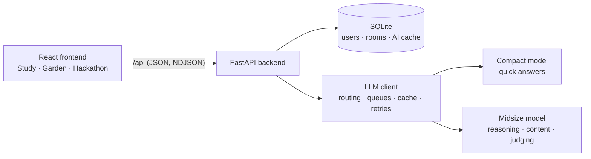

<div align="center">

# 🐧 Athena

### Studying is better with a friend. Meet Pingo.

**Athena makes revising fun, alone and in groups.** One AI companion, Pingo the penguin, tutors you in your language, grows your goals into a garden, rewards every step with XP and crowns, and turns your study group into a hackathon.


*Built for the EdNova Technical Challenge 2026.*

</div>

---

## Why Athena?

Most AI study tools are a chat box for one person. They hand out answers, ignore how you learn, and do nothing for your study group.

Athena is different:

- 🧠 **It learns how you learn.** A quick quiz finds your learning style, and Pingo teaches the way that works for you.
- 🌱 **It makes progress visible.** Every goal is a plant that grows as you master it.
- 👑 **It makes revising a game.** XP, levels, streaks and crowns reward every question.
- 🏆 **It makes groups work.** Team hackathons with an AI brief, a quiz, coding challenges and an AI judge.
- 📚 **Everything to revise is in one place.** Explanations, practice, goals and group study, no more switching apps.

## What you can do

| | Feature | What it does |
|---|---|---|
| 🎓 | **AI tutor** | Ask anything. Pick one of 12 teaching approaches: explain simply, step by step, analogy, worked example, test me, let me discover it, explain my mistakes and more. |
| 🌍 | **Your language** | Learn in English, French, Arabic or Tunisian Darija, with a full right-to-left interface in Arabic. |
| 🧭 | **Learning-style quiz** | Five quick steps and one sentence; the AI picks your style (visual, analogy, steps, examples, practice or direct). |
| 🌱 | **Garden** | Plant study goals, slide your mastery, and watch them bloom. Mastered goals earn 50 XP. |
| 👑 | **XP, levels and crowns** | 10 XP per question. Level up and Pingo's olive sprig becomes a laurel wreath, a golden laurel, the Crown of Athena, then a radiant crown. |
| 🏆 | **Team hackathons** | Host a room, share a 6-letter code, form teams. Pingo writes the study brief, the quiz and an open problem, even from your own course notes. |
| 💬 | **Team Chat** | Chat with teammates (anonymously if you like), **Ask Pingo** for hints, or **Check my explanation** for feedback. Pingo invites quieter teammates in. |
| ⌨️ | **Live competition** | Quiz, coding challenges tested right in your browser (JavaScript and Python), and an open problem judged by AI against a rubric. Revision notes come from your team's mistakes. |

And Pingo is alive: he follows your typing, hides his eyes while you type a password, thinks while the AI works, celebrates when you're right, and falls asleep if you leave him alone. Poke him. Double-click him. 🐧

## How the AI works

Athena runs on the organisers' OpenAI-compatible API and is built to make a small, shared quota feel fast and reliable.



- **Smart routing:** simple questions go to the compact model; reasoning, maths, code, deep teaching approaches and confused students go to the midsize model.
- **Never just fails:** queues with live position, waiting on rate limits, retries with back-off, fallback from midsize to compact, automatic `max_tokens` adjustment, and a 14-day answer cache.
- **Fair sharing:** a per-student limit keeps one person from using the whole team's quota.
- **Feels alive while waiting:** progress streams to the browser and Pingo's mood follows each stage.
- **Works offline too:** if the AI is unavailable, built-in content and heuristics keep every feature usable.
- **Private by default:** emails and phone numbers are removed before anything reaches the AI, and accounts need no email at all.

## Quick start

You need **Python 3.9+** and **Node.js 18+**.

```bash
# 1. Backend
cd backend
python3 -m venv .venv
.venv/bin/pip install -r requirements.txt
cp .env.example .env        # then fill in the values below
.venv/bin/uvicorn main:app --reload --port 8000
```

```bash
# 2. Frontend (in a second terminal)
cd frontend
npm install
npm run dev
```

Open **http://localhost:5173** and say hi to Pingo.

Using VS Code? Run the tasks **ATHENA: 1. Setup**, then **ATHENA: backend** and **ATHENA: frontend**.

### Configuration (`backend/.env`)

| Variable | What to put |
|---|---|
| `LLM_BASE_URL` | Your OpenAI-compatible API URL, ending in `/v1` |
| `LLM_API_KEY` | Your API key (never commit it) |
| `COMPACT_MODEL` | Fast model for quick answers, e.g. `qwen2.5-3b` |
| `MIDSIZE_MODEL` | Stronger model for reasoning, e.g. `llama3.1-8b` |
| `EMBED_MODEL` | Optional embedding model for course search |

Without a key, Athena still runs in offline mode so you can explore the interface.

## Project structure

```
athena/
├── backend/
│   ├── main.py          # API: auth, tutor, garden, stats, hackathon rooms, team chat
│   ├── llm.py           # AI client: routing, queues, quota handling, cache, privacy scrub
│   ├── content.py       # Prompts, teaching styles, routing rules, offline content
│   └── mock_llm.py      # Fake API for testing without a key
└── frontend/src/
    ├── App.jsx          # Home page, sign-up, study, garden, settings
    ├── hackathon.jsx    # Rooms, phases, quiz, coding and open rounds, team chat
    ├── mascot.jsx       # Pingo: moods, eyes, beak, crowns
    ├── garden.jsx       # The garden scene and growing plants
    ├── diagnostic.jsx   # Learning-style quiz
    └── runner.js        # Runs coding challenges in the browser
```

## What's next

- ⚡ **More responsive:** word-by-word streaming, phone layouts and instant answers for common questions.
- 🤖 **From LLM to AI agent:** Pingo plans your revision from exam dates, picks your next goal, sets practice on your weak topics, checks his answers against your course, and follows up after mistakes.
- 💸 **Affordable for everyone:** a free tier for every student, low fees for heavier AI use, and group plans for schools and clubs, so price never stands between a student and learning.
- 🏫 **Ready to scale:** PostgreSQL, embedding search, verified quizzes and progress reports for teachers.

<div align="center">

**Made with 💙 and a lot of penguin energy by Mariam Chaari and team.**

</div>
